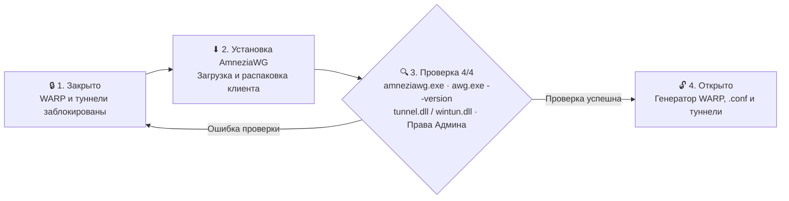



# ⚡ ZapretBridge

**Единая панель для Windows: Flowseal Zapret + AmneziaWG / WARP + VLESS + Steer + Hosts / DoH**

[-0078D6?style=for-the-badge&logo=windows&logoColor=white)](https://github.com/sakleam1414/ZapretBridge)

 

---

## ✨ Возможности ZapretBridge

| Раздел | Что умеет |
| :--- | :--- |
| 🛡️ **Zapret (Flowseal v1.10.4)** | Встроенные 22 официальные стратегии, `GameFilter`, `IPSet Filter`, `TCP Timestamps`, диагностика системы и автотест стратегий. |
| 🌀 **AmneziaWG и WARP** | Безопасная активация (**Закрыто → Установка → Проверка 4/4 → Открыто**), генератор бесплатного Cloudflare WARP и импорт `.conf`. |
| ⚡ **VLESS и Подписки** | Поддержка `vless://`, `trojan://`, `hysteria2://`, `ss://`, `vmess://`, подписки и автовыбор самого быстрого сервера. |
| 🔀 **Steer (Раздельная маршрутизация)** | Умный выбор сайтов и программ (`.exe`), которые пойдут через туннель, и исключений, идущих напрямую. |
| 🌐 **Hosts и DoH** | Быстрые наборы для `hosts` (`GeoHide EU/US`, `malw.link`) и шифрованный DNS (DoH). |
| 🎨 **Оформление и Сервис** | 15 тем оформления, живой фон, размытие IP/ключей для скриншотов, монитор сети и бэкапы `.zmb`. |

---

## 🌀 Порядок запуска AmneziaWG

Раздел **AmneziaWG** остаётся **закрытым** до установки клиента и прохождения всех проверок:

---

## 📦 Файлы и установка

| Файл | Назначение |
| :--- | :--- |
| **[`ZapretBridge_Setup.exe`](https://github.com/sakleam1414/ZapretBridge/raw/main/ZapretBridge_Setup.exe)** | Полноценный установщик для Windows (ярлыки, автозапуск, загрузка `sing-box`, удаление). |
| **[`ZapretBridge.exe`](https://github.com/sakleam1414/ZapretBridge/raw/main/ZapretBridge.exe)** | Актуальный исполняемый файл панели (портативный запуск или обновление). |

### Быстрая установка
1. Скачайте **`ZapretBridge_Setup.exe`** и запустите от имени **Администратора**.
2. Для портативного запуска без установки скачайте **`ZapretBridge.exe`**.
3. Обновления программы публикуются в разделе **[Releases](https://github.com/sakleam1414/ZapretBridge/releases)** и подхватываются встроенной кнопкой **«Проверить обновления»** внутри панели.
